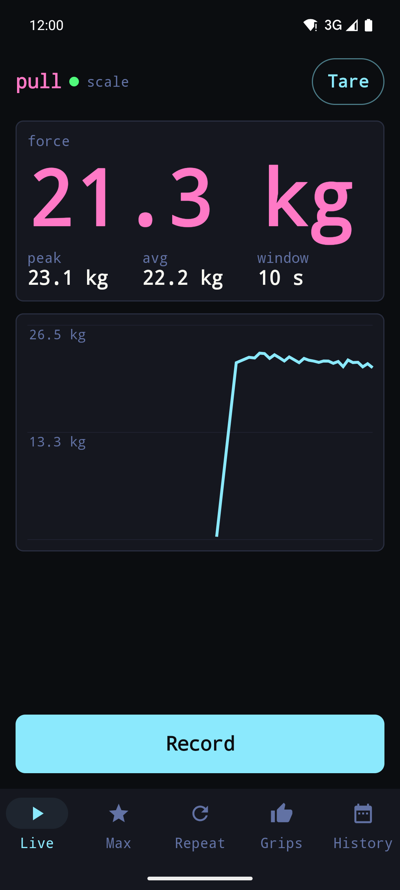
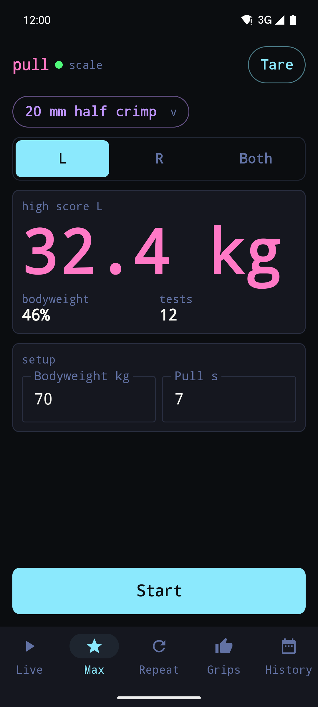
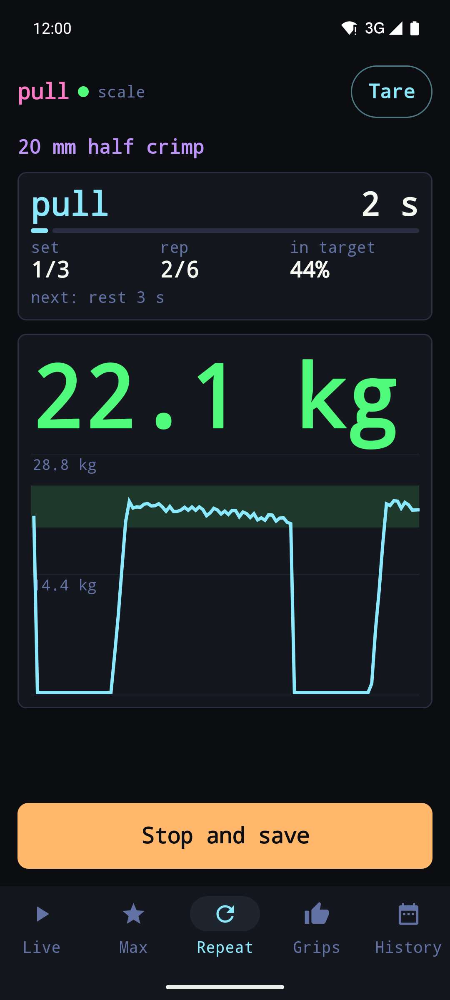
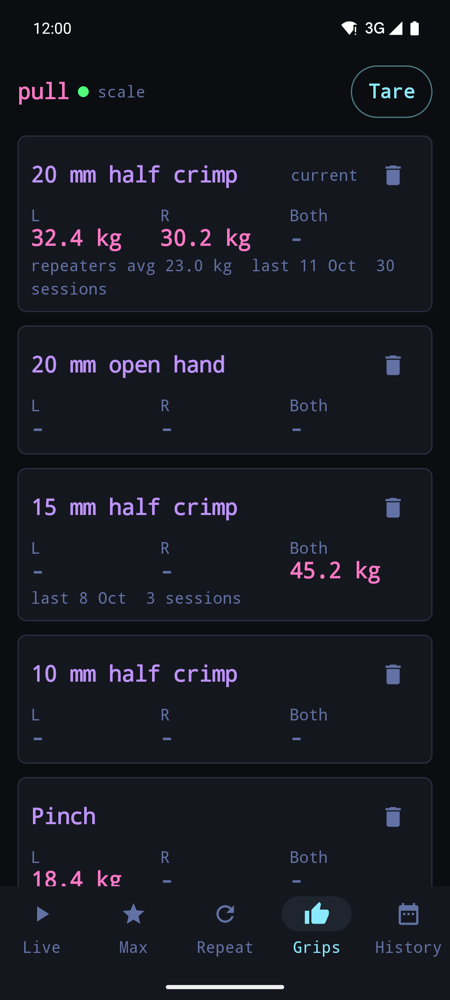
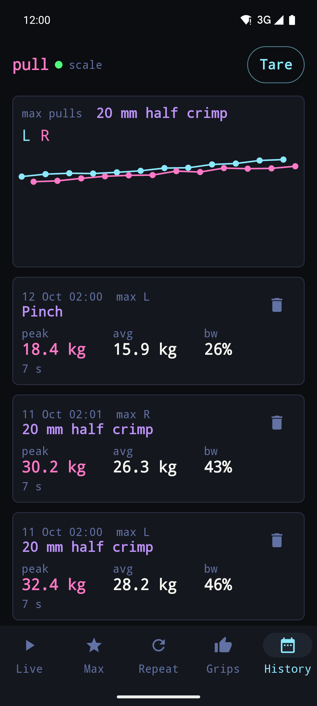

# pull

Android force trainer for the WH-C06 Bluetooth crane scale, a cheap stand-in for a Tindeq Progressor: live force, max pull tests, repeaters and per-grip high scores.

<table>
  <tr>
    <td align="center"><br><sub>Live</sub></td>
    <td align="center"><br><sub>Max</sub></td>
    <td align="center"><br><sub>Repeaters</sub></td>
    <td align="center"><br><sub>Grips</sub></td>
    <td align="center"><br><sub>History</sub></td>
  </tr>
</table>

## Build

```sh
brew install prek && prek install
./gradlew testDebugUnitTest assembleDebug
adb install -r app/build/outputs/apk/debug/app-debug.apk
ANDROID_SERIAL=emulator-5554 scripts/screenshots.sh   # regenerates docs/screenshots, emulator only
```

## Install

Releases carry a signed `pull-<version>.apk`; add the repo to [Obtainium](https://github.com/ImranR98/Obtainium) for updates (while the repo is private, Obtainium needs a GitHub token).

## Use

Switch the scale on, open the app and allow Bluetooth and location; it locks onto the first WH-C06 it hears. Press Tare with nothing hanging.

| Tab | What it does |
|---|---|
| Live | force, peak and average over the last 10 s; Record saves a session |
| Max | countdown, timed max pull per grip and hand, high score and bodyweight percentage |
| Repeat | work/rest repeaters with sets, a target band and time in target |
| Grips | add and delete grips, best max per hand |
| History | every session and the max-pull trend for the current grip |

## Layout

| Path | Contents |
|---|---|
| `app/src/main/kotlin/Scale.kt` | scan, packet decode, tare, debug demo feed |
| `app/src/main/kotlin/Store.kt` | sessions, grips, high scores, settings |
| `app/src/main/kotlin/Screens.kt` | the five tabs |
| `app/src/main/kotlin/Theme.kt` | palette, type scale, shared components |
| `app/src/main/kotlin/tokens/Tokens.kt` | colours and radii vendored from [JakobMelchard/web](https://github.com/JakobMelchard/web) `dist/tokens.kt` |
| `scripts/` | `screenshots.sh` and its demo sessions |
| `.github/workflows/release.yml` | release-please, then the signed APK |

## License

[MIT](LICENSE)
